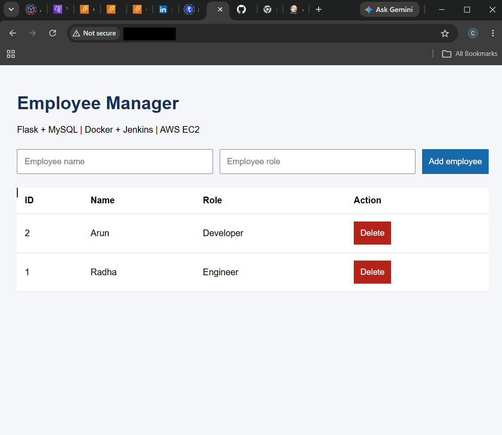
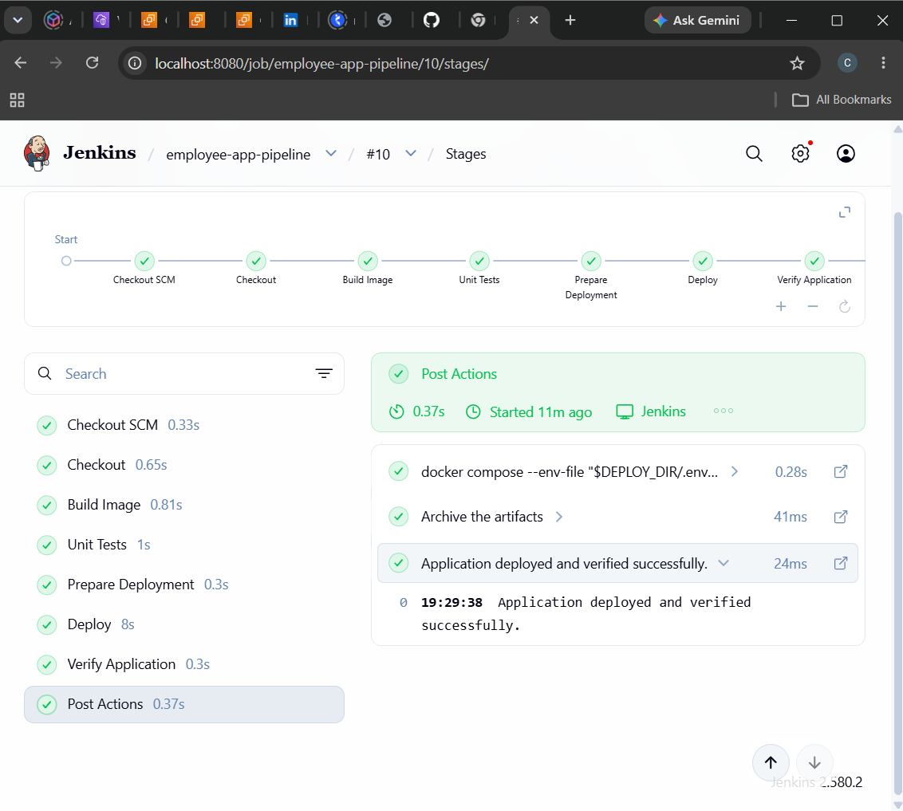

# Two-Tier Flask + MySQL App on AWS (Docker + Jenkins)

An employee manager (add / list / delete) built as two tiers, **Flask + Gunicorn** and **MySQL 8.4**, running in Docker Compose on an EC2 instance in a custom VPC, and deployed automatically by a **Jenkins** pipeline.



## Highlights

- Custom VPC (`10.20.0.0/16`) with a public subnet; SSH and HTTP limited to the admin IP.
- MySQL is **not** published to the host; the app reaches it over the Compose network as `db`.
- Data persists in a named Docker volume across web redeployments.
- Jenkins pipeline: Checkout → Build Image → Unit Tests → Prepare Deployment → Deploy → Verify.
- Failing tests **block** deployment (demonstrated in build #6).
- `/health` (process up) and `/ready` (database reachable; returns 503 if not).

## Pipeline



## Run locally

```bash
git clone https://github.com/Chandan13-hub/two-tier-flask-jenkins.git
cd two-tier-flask-jenkins
# create a .env with your own DB credentials (never commit it); see compose.yaml for variable names
docker compose --env-file .env up -d --build
curl http://127.0.0.1/ready
```

## Documentation

Full design, validation table and evidence: [`docs/project-report.md`](docs/project-report.md).

## Security notes

No secrets are stored in this repository. Runtime credentials live in `/opt/employee-app/.env` (mode 600) on the server. The app currently serves plain HTTP with no authentication, so it is intended for a restricted lab environment only.
