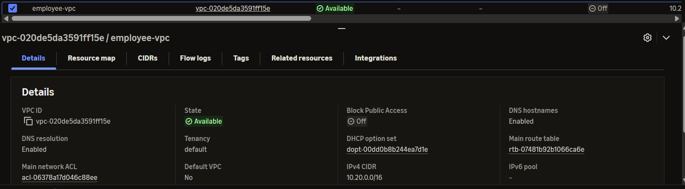
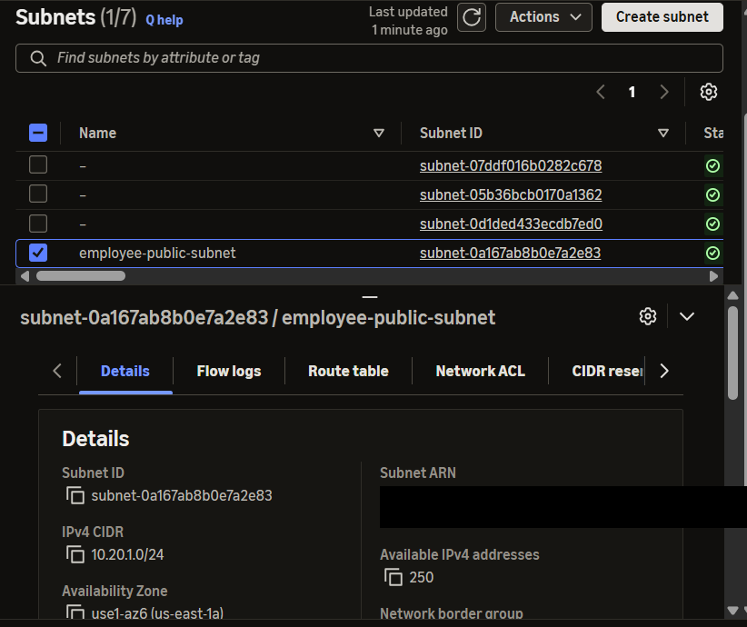
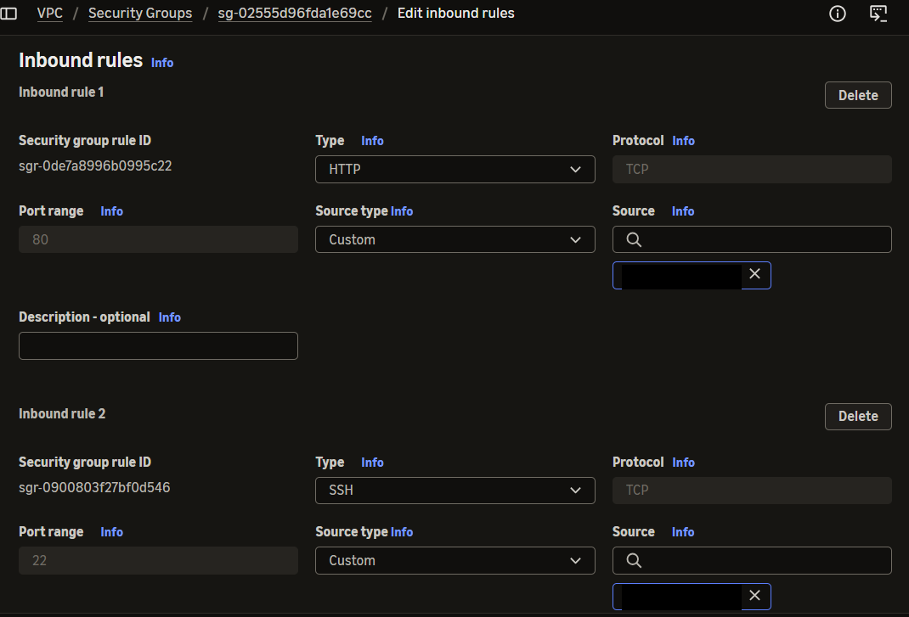
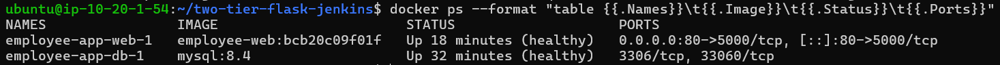
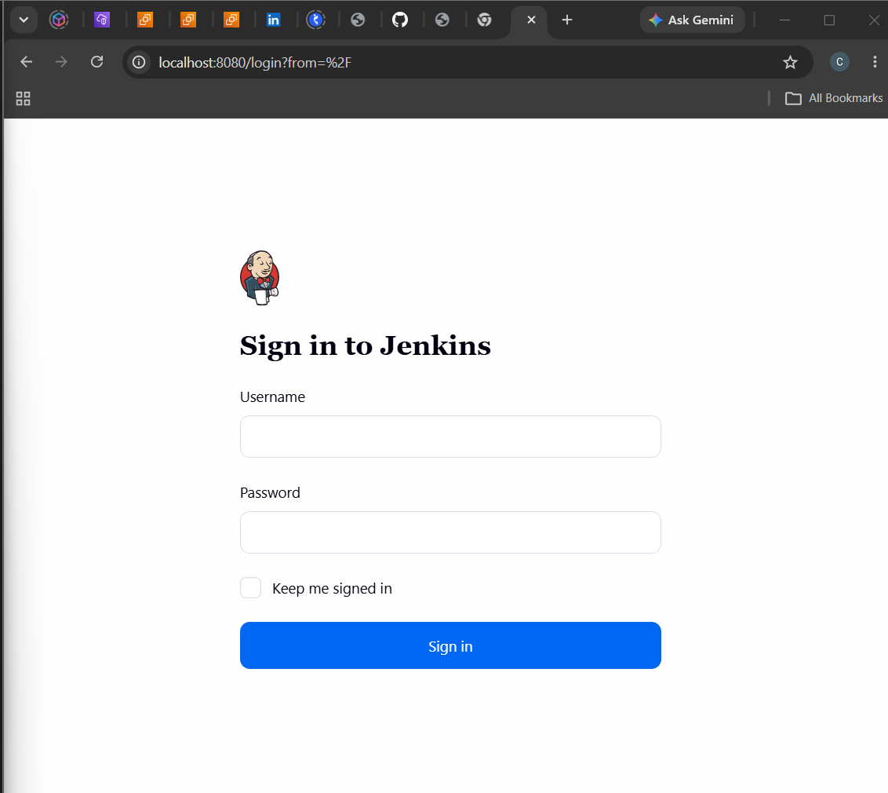

# Two-Tier Flask–MySQL Web Application on AWS with Docker and Jenkins

**Status: implemented and verified, with the exceptions listed in [Remaining limitations](#13-remaining-limitations).** Every "Verified" claim below links to a real screenshot in `docs/screenshots/`. Items without a screenshot are marked *Not demonstrated*.

---

## 1. Project overview

A two-tier employee management application on an AWS EC2 instance inside a custom VPC. Flask (served by Gunicorn) handles HTML pages and requests; MySQL stores employee records. Docker packages each tier and Docker Compose coordinates them. GitHub holds the source, and a Jenkins pipeline checks out the repository, builds a commit-tagged image, runs unit tests, deploys, and verifies readiness.

## 2. Objectives

- Add, list and delete employees.
- Use a custom AWS network instead of the default VPC.
- Run Flask and MySQL as two tiers; keep the database port off the host interface.
- Persist database data independently of the Flask container.
- Automate test and deployment through Jenkins, with failing tests blocking deployment.
- Keep infrastructure small and low-cost for a learning environment.

Editing employee details is a possible future enhancement and is not implemented.

## 3. Technology stack

| Component | Technology | Purpose |
|---|---|---|
| Cloud | AWS EC2 | Hosts the application and Jenkins |
| Network | Custom VPC, subnet, route table, Internet Gateway, security group | Controlled connectivity |
| OS | Ubuntu Server 24.04 LTS, x86_64 | Host environment |
| Application tier | Python Flask + Gunicorn | HTML and request handling |
| Database tier | MySQL 8.4 | Employee records |
| Containers | Docker Engine, Docker Compose | Isolation and service definition |
| Source control | Git, GitHub | Version control |
| CI/CD | Jenkins 2.580.2 Pipeline | Build, test, deploy, verify |
| Testing | Python `unittest` + HTTP readiness checks | Behaviour validation |

## 4. Architecture

```
Developer -> GitHub repository
                 | Jenkins repository polling
                 v
Custom VPC: 10.20.0.0/16
  Public subnet: 10.20.1.0/24
    EC2 instance
      Jenkins (host)
        -> Checkout -> Build -> Test -> Deploy -> Verify
      Docker Compose project: employee-app
        Flask + Gunicorn container
          Host port 80 -> Container port 5000
                  | db:3306
                  v
        MySQL container (named volume)

Laptop -> SSH tunnel -> Jenkins on 127.0.0.1:8080
Browser -> EC2 port 80 -> Flask application
```

Jenkins is deployment infrastructure, not a third application tier. There is no separate frontend or Nginx service.

## 5. Network and access design

| Resource | Configuration | Evidence |
|---|---|---|
| VPC | `employee-vpc`, 10.20.0.0/16, not the default VPC |  |
| Subnet | `employee-public-subnet`, 10.20.1.0/24, us-east-1a |  |
| SSH inbound | TCP 22 from administrator's public IP /32 |  |
| HTTP inbound | TCP 80 from administrator's public IP /32 | (same) |
| MySQL | No public rule, no published host port |  |
| Jenkins access | SSH tunnel to `localhost:8080` |  |

The EC2 host's private address (`10.20.1.x`) in the terminal screenshots falls inside the custom subnet. Account ID and public IPs were redacted from the screenshots before publication.

## 6. Application

| Route | Method | Purpose |
|---|---|---|
| `/` | GET | Render employee list |
| `/employees` | POST | Insert an employee |
| `/employees/<id>/delete` | POST | Delete an employee |
| `/health` | GET | Process responds (does not check the database) |
| `/ready` | GET | Employee table can be queried; 503 on database failure |

Input validation rejects empty names/roles and values over 100 characters. Queries are parameterized.

## 7. Repository layout

```
two-tier-flask-jenkins/
  app/app.py, requirements.txt, templates/index.html
  database/init.sql
  tests/test_app.py
  Dockerfile
  compose.yaml
  Jenkinsfile
  .dockerignore
  .gitignore
  README.md
  docs/project-report.md
  docs/screenshots/
```

Secrets are kept out of the repository. The deployment environment file lives at `/opt/employee-app/.env` with mode `600`, owned by `jenkins` (see [rollback/deploy directory listing](screenshots/11-rollback-tag-files.png)).

## 8. Container and storage design

Python slim image, Gunicorn, non-root application user. Compose defines `web` and `db` on a shared bridge network; the app reaches MySQL via hostname `db`. Only `web` publishes a host port. MySQL uses a named volume that normal redeployments preserve. `docker compose down -v` deletes that volume and must never be part of routine deployment. A named volume is not a backup; backup/restore is future work.

## 9. Jenkins CI/CD workflow

Stages: **Checkout SCM → Checkout → Build Image → Unit Tests → Prepare Deployment → Deploy → Verify Application → Post Actions.**

- Image tag is the Git commit (e.g. `employee-web:bcb20c09f01f`).
- Deployment files live in `/opt/employee-app`, outside temporary workspaces.
- `current-image-tag` and `previous-image-tag` files are kept for manual application rollback; database rollback is not included.
- Concurrent builds are disabled; repository polling is used instead of a webhook.

## 10. Validation results

| Validation | Result | Evidence |
|---|---|---|
| Unit tests | **Verified.** Suite of 4 tests runs; passes in builds #7 and #10 | [#10](screenshots/08-jenkins-pipeline-success-build10.png), [#7](screenshots/08b-jenkins-pipeline-success-build7.png) |
| Container health | **Verified.** `web` and `db` both `(healthy)` | [compose ps](screenshots/06-compose-ps-healthy.png) |
| MySQL not exposed | **Verified.** `db` shows only internal `3306/tcp, 33060/tcp`; no host mapping | [docker ps](screenshots/06b-mysql-port-not-published.png) |
| Application access | **Verified.** Employee page loads from the permitted IP | [app](screenshots/05-running-application-add.png) |
| Add / delete | **Verified.** Two records shown, then one after deleting a record | [add](screenshots/05-running-application-add.png), [delete](screenshots/05b-delete-employee.png) |
| Persistence | **Verified.** Records remain after Jenkins replaced the web container (db uptime exceeds web uptime) | [redeploy](screenshots/09-deployment-change-visible.png), [compose ps](screenshots/06-compose-ps-healthy.png) |
| Jenkins deployment | **Verified.** All stages green in builds #7 and #10 | [#10](screenshots/08-jenkins-pipeline-success-build10.png) |
| Visible change after deploy | **Verified.** Page heading changed to "Deployed by Jenkins" | [change](screenshots/09-deployment-change-visible.png) |
| Failed-test protection | **Verified.** Build #6: a deliberately broken test (`200 != 201`) failed Unit Tests; Prepare Deployment, Deploy and Verify were skipped | [commit](screenshots/07c-commit-that-broke-test.png), [failure](screenshots/07-unit-test-failure-build6.png), [skipped stages](screenshots/07b-failed-test-blocks-deploy.png) |
| Dependency readiness | **Verified.** `/ready` returned 503 `not_ready` when the database was unavailable, then 200 `ready` once restored | [503](screenshots/06c-ready-503-db-unavailable.png), [200](screenshots/06d-ready-200-restored.png), [after redeploy](screenshots/06e-ready-after-redeploy.png) |
| Image rollback | **Partially verified.** Tag-tracking files exist; an actual rollback redeploy was *not demonstrated* | [files](screenshots/11-rollback-tag-files.png) |
| GitHub push | **Verified.** Jenkins checks out commits authored from the GitHub repository (e.g. `28e8886`) | [commit](screenshots/07c-commit-that-broke-test.png) |
| Credential hygiene | **Verified.** Scan of tracked files and Git history found no key/credential files; the only match is `DB_PASSWORD` read from an environment variable | [scan](screenshots/13-secret-scan.png) |

## 11. Issue encountered and resolved: GitHub authentication

The first push failed because GitHub no longer accepts account passwords for Git over HTTPS:

```
remote: Invalid username or token.
Password authentication is not supported for Git operations.
fatal: Authentication failed
```

The fix is a repository-scoped fine-grained personal access token (Contents: read/write) or SSH key authentication. Tokens must not be embedded in remote URLs, committed, or shown in screenshots. Later Jenkins checkouts of the repository (see section 10) confirm the push succeeded.

## 12. Security considerations

- HTTP and SSH are restricted to the administrator's IP; Jenkins is reachable only through an SSH tunnel.
- MySQL is never published; credentials stay outside Git.
- Docker-enabled Jenkins execution is privileged; run only trusted code.
- Before any wider exposure add authentication, authorization, CSRF protection and HTTPS. The app is served over plain HTTP ("Not secure" in the browser).

## 13. Remaining limitations

- EC2 instance type and monthly cost are not recorded; no benchmark was taken.
- Actual image rollback is not demonstrated.
- No tested backup/restore of the MySQL volume.
- Single-host design; no registry, no automatic rollback, no structured Jenkins test reports.
- Port 33060 (MySQL X protocol) is listed as an internal container port only; it is not published.

## 14. Future improvements

Employee editing and more tests; authentication, CSRF and HTTPS; JUnit-style Jenkins test reports; database migrations and tested backups; separate Jenkins host; container registry with retention; automatic rollback with compatibility checks; measured cost and resource use.

## Conclusion

The project connects application development, custom AWS networking, containerization, persistent storage, source control and CI/CD in one environment. A real pipeline run deployed the app, a deliberately failing test blocked deployment, and the database stayed private and persistent across redeploys.
